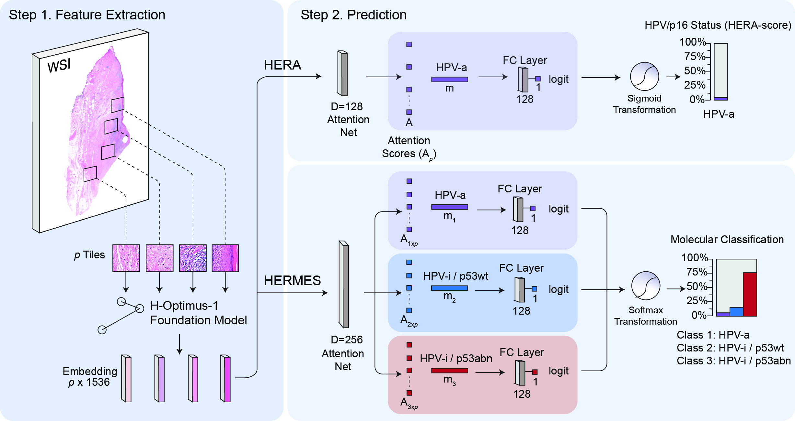

# HERA and HERMES - Predicting HPV-Status and Molecular Subtypes from WSIs in Vulvar Squamous Cell Carcinoma using Deep Learning

| Model | Task | Classes |
|-------|------|---------|
| **HERA** | Binary classification | HPV-associated (HPV-a) vs HPV-independent (HPV-i) |
| **HERMES** | Three-class molecular subtyping | HPV-a, HPV-i/p53wt, HPV-i/p53abn |

Both models are attention-based multiple instance learning (ABMIL) models trained on tile-level features from the **H-optimus-1** pathology foundation model.



---

## Model Description
- **Architecture:** Attention-based Multiple Instance Learning (ABMIL) on H-optimus-1 tile embeddings (1536-d)
- **HERA:** one attention branch, sigmoid output (HPV-a vs HPV-i)
- **HERMES:** one attention branch per class, one linear head per class, softmax output over HPV-a, HPV-i/p53wt and HPV-i/p53abn
- **Explainability:** attention heatmaps highlight the morphology driving each prediction. For HERMES, the three class-specific attention maps are combined into one RGB map.

---

## Installation
Create a conda environment and install dependencies:

```bash
conda create -n hpv-ai python=3.10
conda activate hpv-ai
pip install -r requirements.txt
```

OpenSlide and libvips must also be available on your system for reading WSIs.

---

# Step-by-Step Usage Guide

## Step 1. Feature extraction with H-optimus-1

**Purpose:** Extract tile-level features from WSIs for training and inference.

```bash
python -u ./extract_features.py \
  --input_slide "${slide}" \
  --output_dir "${output_dir}" \
  --path_Hoptimus1_weights "/path/to/HOPTIMUS1_WEIGHTS" \
  --tile_size 180 --mpp 0.25 --batch_size 16 --workers 4 --red_filter 0
```

**Arguments:**
- `--input_slide`: Path to the input WSI (.mrxs, .tiff, .svs, .ndpi, etc.)
- `--output_dir`: Directory to save the `.h5` feature files and a tile QC image
- `--path_Hoptimus1_weights`: Path to the pretrained H-optimus-1 weights
- `--tile_size`: Tile size in µm (180 was used here)
- `--mpp`: Slide resolution in µm/pixel, if it cannot be read from the slide metadata
- `--red_filter`: Set to 1 to first turn all-red scanner background pixels white
- `--batch_size`, `--workers`: Throughput settings

**Output:** `slideID_features.h5`.

---

## Step 2. Training

**Manifest format** (HERA uses `HPV_status`, HERMES uses `HPV_p53_classification`):
```csv
slide_id,HPV_status,Cohort
case001,1,cohortA
case002,0,cohortA
```
HERMES class labels are `HPVpos`, `HPVneg/p53wt` and `HPVneg/p53abn`, mapped to indices 0, 1 and 2.

**HERA:**
```bash
python train_HERA.py --manifest_training data/HERA_training.csv --manifest_intval data/HERA_internalvalidation.csv \
  --data_dir data/hoptimus1_features/ --input_feature_size 1536 --foundationtype hoptimus1 --hp 1 --workers 4 \
  --output_dir outputs/HERA
```

**HERMES:**
```bash
python train_HERMES.py --manifest_training data/HERMES_training.csv --manifest_intval data/HERMES_internalvalidation.csv \
  --data_dir data/hoptimus1_features/ --input_feature_size 1536 --foundationtype hoptimus1 --hp 1 --workers 4 \
  --output_dir outputs/HERMES
```

**Key arguments:**
- `--manifest_training`, `--manifest_intval`: CSVs for the training and internal validation sets
- `--data_dir`: Folder with the `.h5` feature files
- `--hp`: Hyperparameter set ID (see the `base_hparams` and hyperparameter sets in the training script)
- `--output_dir`: Where checkpoints, predictions, TensorBoard runs and `run_history_*.txt` are written

**Output:** `<output_dir>/checkpoints/*_checkpoint.pt` and `<output_dir>/predictions/*_predictions.csv`

---

## Step 3. Inference

```bash
python test_HERA.py --manifest_test data/manifest_test.csv --data_dir data/hoptimus1_features/ \
  --checkpoint_HERA_model checkpoints/HERA_checkpoint.pt --input_feature_size 1536 \
  --config_file configs/config_HERA.yaml --output_dir predictions/HERA

python test_HERMES.py --manifest_test data/manifest_test.csv --data_dir data/hoptimus1_features/ \
  --checkpoint_HERMES_model checkpoints/HERMES_checkpoint.pt --input_feature_size 1536 \
  --config_file configs/config_HERMES.yaml --output_dir predictions/HERMES
```

**Output:** `predictions_<cohort>_N<n>.csv` with probabilities, logits, label and slide ID. HERMES additionally reports the per-class and macro AUC.

---

## 🧩 Explainability

```bash
python visualize_heatmap_HERA.py --input_slide <slide> --data_dir data/hoptimus1_features/ \
  --checkpoint_HERA checkpoints/HERA_checkpoint.pt --input_feature_size 1536 \
  --config_file configs/config_HERA.yaml --output_dir results/heatmaps_HERA

python visualize_heatmap_HERMES.py --input_slide <slide> --data_dir data/hoptimus1_features/ \
  --checkpoint_HERMES checkpoints/HERMES_checkpoint.pt --input_feature_size 1536 \
  --config_file configs/config_HERMES.yaml --output_dir results/heatmaps_HERMES
```

The HERMES heatmap maps HPV-a to blue, HPV-i/p53wt to green and HPV-i/p53abn to red.

---

## Repository Structure
```
HPV-AI/
├── HERA.py / HERMES.py            # model definitions
├── model_basics.py                # attention and FC building blocks
├── extract_features.py            # H-optimus-1 feature extraction
├── train_HERA.py / train_HERMES.py
├── test_HERA.py / test_HERMES.py
├── visualize_heatmap_HERA.py / visualize_heatmap_HERMES.py
├── utils_HERA.py / utils_HERMES.py / utils_heatmap.py
├── configs/                       # network settings per model
└── figures/
```

---

## Citation
If you use HERA or HERMES in your research, please cite:

> **TBD**  
> [van den Berg et al., TBD]. *Journal Name (under review) TBD*.

